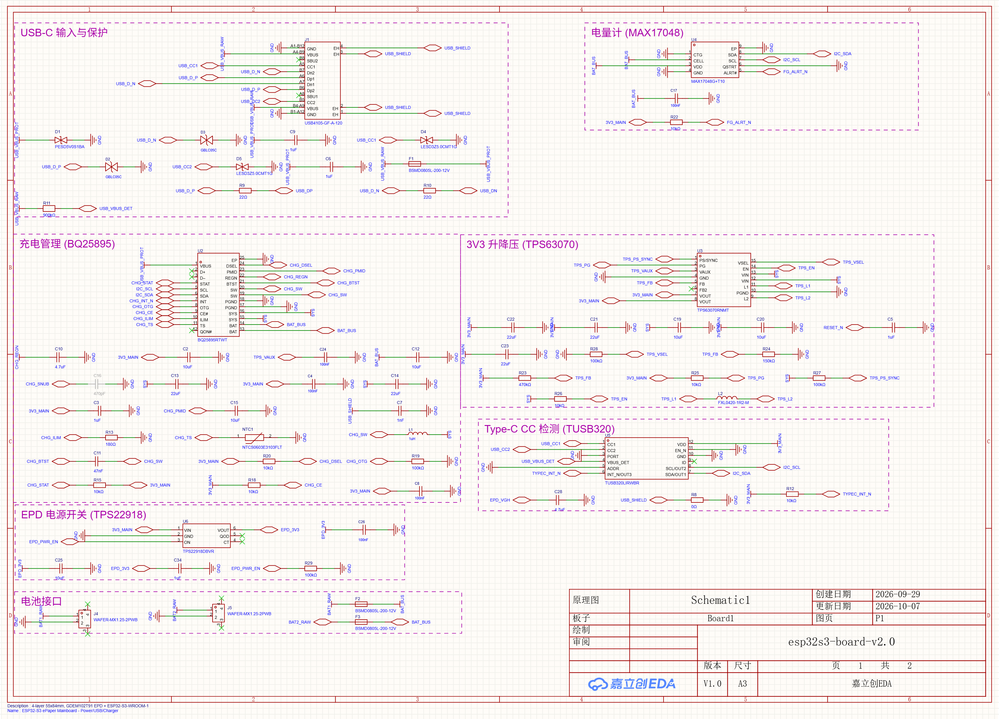
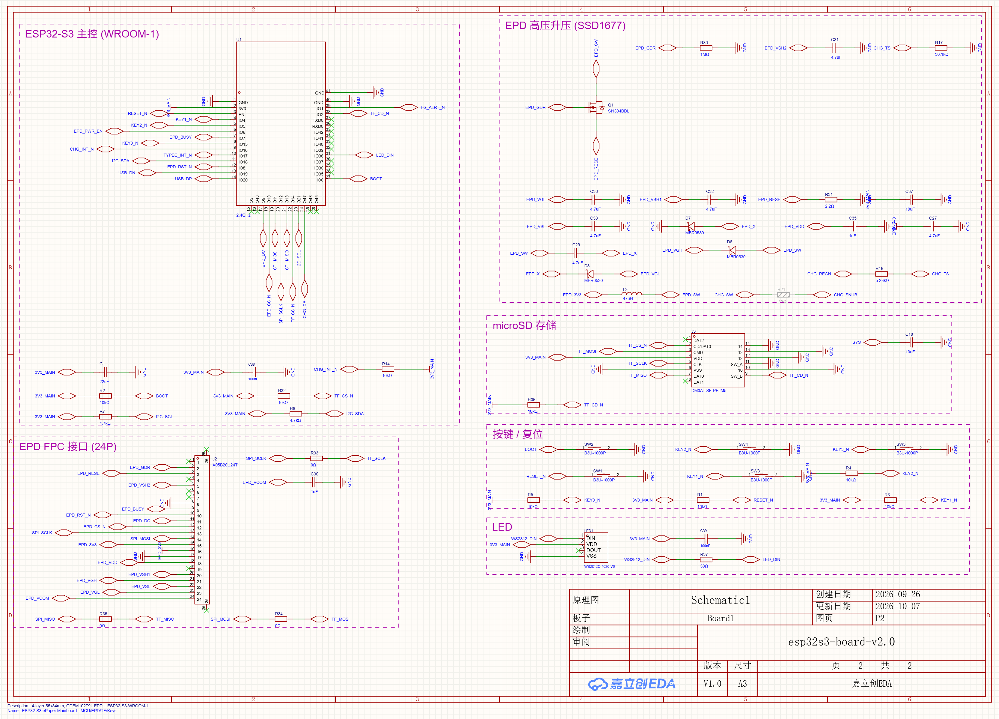

# ESP32-S3 墨水屏主板 v2.0 - 软件开发手册

面向 **PlatformIO + Arduino** 固件开发的硬件参考手册。

> **数据来源**：EasyEDA Pro 工程 `esp32s3-board-v2.0` 的现场回读（只读），
> 原理图 **Schematic1 P1/P2、版本 V1.0、图框 A3、图签更新日期 2026-10-07**；
> 本手册生成于 **2026-10-10**。
> 所有引脚/网络来自原理图网表（`sch read`），器件参数来自数据手册原文（本地 PDF）与 `design/model.json`。
> 原始回读数据见 `scan/sch-P1.json`、`scan/sch-P2.json`（原理图网表）、`scan/pcb-components.json`（器件 LCSC/MPN），
> 提取脚本见 `scan/*.py`。

---

## 0. 原理图

**P1 - 电源 / USB / 充电 / 电量计 / Type-C / EPD 电源开关**



**P2 - ESP32-S3 主控 / 墨水屏 24P / microSD / 按键 / LED / EPD 高压升压**



> 矢量版：`schematic/P1_power_usb.svg`、`schematic/P2_mcu_epd.svg`（可无损放大查看走线与网络标号）。
> 两页均为 **A3 / V1.0**，图签更新日期 **2026-10-07**。

---

## 1. 硬件一览

| 项 | 参数 |
|---|---|
| 板框 | 55.000 × 84.000 mm，4 层板（Top / Inner1 GND 内电层 / Inner2 3V3 内电层 / Bottom） |
| 主控 | **ESP32-S3-WROOM-1-N16R8**（16 MB Flash + 8 MB PSRAM，2.4 GHz Wi-Fi + BLE，LCSC C2913202） |
| 供电 | USB-C 5 V → BQ25895（NVDC 充电/电源路径）→ SYS → **TPS63070 升降压 → 3V3_MAIN (3.3 V)** |
| 电池 | J4 / J5 双路 1.25 mm 接口（单节锂电，可单接或双接） |
| 显示 | 10.2" 电子纸 **GDEM102T91**（SSD1677 驱动，960 × 640），24P / 0.5 mm FPC（J2） |
| 存储 | microSD（J3，SPI 模式，与墨水屏共用 SPI 总线） |
| 按键 | SW1 RESET / SW2 BOOT / SW3·SW4·SW5 三个用户键 |
| 指示 | LED1 = WS2812C-4020-V6（单颗可寻址 RGB，3.3 V 供电） |
| I2C 从机 | BQ25895（充电器）、MAX17048（电量计）、TUSB320LI（Type-C 控制器） |

## 2. 系统框图

```text
        USB-C J1                                   ┌──────────────┐
   VBUS ─[F1 2A PPTC]─ USB_VBUS_PROT ─────────────►│ BQ25895      │
   D+/D- ─[R9/R10 22Ω]────────────────► GPIO20/19 │ U2  充电器    │
   CC1/CC2 ───► TUSB320LI U5 ◄────────────────────►│ I2C 0x6A     │
                                                   └──┬────────┬──┘
   J4/J5 (电池) ─[F2/F3]─ BAT_BUS ────────────────────┘        │ SYS
                             │                                 │
                        MAX17048 U4                            ▼
                        I2C 0x36                     TPS63070 U3 (Buck-Boost)
                             │                                 │
                             │                          3V3_MAIN (3.3 V)
                             │                                 │
                             │                ┌────────────────┼───────────────┐
                             │                │                │               │
                             │            ESP32-S3 U1     TPS22918 U6      传感器/上拉
                             │                │                │
                             └── I2C ─────────┘           EPD_3V3 ──► J2 (24P FPC)
                                                                 + 板载高压升压
                                                                   (L3/Q1/D6-D8)
```

## 3. 文档索引

| 文档 | 内容 |
|---|---|
| [PINOUT.md](PINOUT.md) | MCU GPIO 全表、24P FPC、microSD、按键、LED、电源网络、strap 引脚 |
| [POWER_AND_CHARGING.md](POWER_AND_CHARGING.md) | 电源树、充电机制、上电时序、BQ25895/MAX17048 寄存器速查、固件初始化清单 |
| [I2C_DEVICES.md](I2C_DEVICES.md) | I2C 总线电气参数、三颗从机地址/寄存器、读写范例、故障排查 |
| [EPD_INTERFACE.md](EPD_INTERFACE.md) | 墨水屏 24P 接口、高压升压原理、驱动要点与时序 |
| [PLATFORMIO.md](PLATFORMIO.md) | PlatformIO/Arduino 工程搭建、烧录、库选型、示例代码 |
| [platformio/](platformio/) | 可直接 `pio run` 的模板工程（含 `board_pins.h` 与自检 demo） |
| [schematic/](schematic/) | 原理图 P1/P2（PNG 位图 + SVG 矢量） |
| [scan/](scan/) | 现场回读原始数据与提取脚本（可复现） |

## 4. 快速上手（3 步）

```bash
# 1. 复制模板工程
cp -r dev/platformio my-firmware && cd my-firmware

# 2. 编译并烧录（USB-C 直连，模组原生 USB 下载）
pio run -t upload

# 3. 串口监视（USB CDC，115200）
pio device monitor
```

默认 `src/main.cpp` 会：扫描 I2C 总线 → 读取三颗从机 → 打印器件 ID/电压/SOC/充电状态 →
读取三个按键 → 点亮 WS2812 → 开关一次墨水屏电源。可作为"板子是否正常"的自检程序。

## 5. 开发前必读的 6 个硬约束

1. **墨水屏默认断电**：`EPD_3V3` 由 TPS22918 门控，`EPD_PWR_EN`(GPIO6) 有 100 kΩ 下拉，
   上电为**关断**。用屏之前必须先拉高 GPIO6，并把 SPI 相关引脚先置为安全电平。
2. **充电默认禁止**：BQ25895 的 `/CE`(GPIO47) 有 10 kΩ 上拉，复位后**默认不充电**。
   固件必须完成 I2C 配置并回读校验后才拉低 GPIO47（详见 POWER_AND_CHARGING.md §4）。
3. **BQ25895 看门狗默认开启**（40 s）。不喂狗/不关闭，寄存器会回滚到默认值，表现为
   "充电一会儿就停"。建议初始化时把 WATCHDOG 位写 00 关闭（数据手册 §8.4.8 REG07 说明）。
4. **没有硬件充电状态脚**：`CHG_STAT`(/CHG) 只做了 10 kΩ 上拉，**没有接到 MCU**。
   充电状态只能通过 I2C + `/INT`(GPIO16) 获取。
5. **SPI 是共享总线**：墨水屏与 microSD 共用 SCLK/MOSI（MISO 只接卡）。
   两者片选独立，但**不能同时使能**；切换设备时要先拉高对方的 CS。
6. **USB 用的是模组原生 USB**（GPIO19/20，经 22 Ω 串阻）。固件里启用 USB CDC 后，
   串口监视走 USB，不再需要外接 USB-TTL。

## 6. 与旧文档的差异（重要）

本手册按**现场实际设计**编写。与 `PCB_INTERFACE_POSITIONS.md` §7.2 的旧表相比有一处功能差异：

| 项 | 旧文档 §7.2 | 本手册（现场实测） |
|---|---|---|
| GPIO38（模组 31 脚） | 列为未使用 NC | **实际接了 `LED_DIN` → R37 33 Ω → WS2812 LED1** |

其余 GPIO 分配与旧文档一致（已逐条复核）。硬件布局偏差（连接器位置、按键间距）见
`PCB_INTERFACE_POSITIONS.md` §11，**不影响固件**。

## 7. 复现与校验

```powershell
# 重新回读原理图/PCB（需要 EasyEDA 打开工程 + connector 已连接）
easyeda health
easyeda sch read --page 7b1ca0ce011868e2 --project c4799361d2dd4e09bdd31ddc8a57a1ba   # P1
easyeda sch read --page f568f62f67600e3d --project c4799361d2dd4e09bdd31ddc8a57a1ba   # P2
easyeda sch export-image --format png --page 7b1ca0ce011868e2 --project c4799361d2dd4e09bdd31ddc8a57a1ba --out schematic/P1_power_usb.png
easyeda sch export-image --format png --page f568f62f67600e3d --project c4799361d2dd4e09bdd31ddc8a57a1ba --out schematic/P2_mcu_epd.png

# 提取数据手册事实（I2C 地址、寄存器）
python scan/extract_datasheet_facts.py
python scan/dump_pdf_pages.py bq25895.pdf 32 36 39 40 41 43
```

数据手册位于 `../../../esp32-board-v1.1/datasheets/`（BQ25895 / MAX17048 / TUSB320LI / SSD1677 /
ESP32-S3-WROOM-1 / GDEM102T91 等）。
